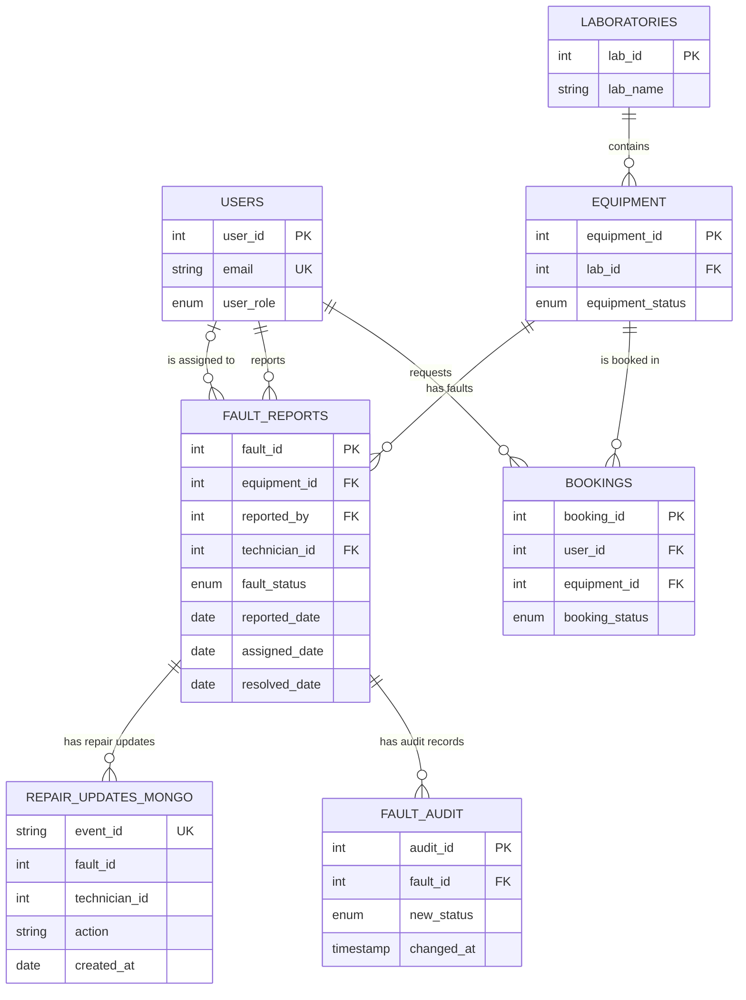

# LabTrack – Entity Relationship Diagram

The following ER diagram represents the database structure of the LabTrack Laboratory Equipment Booking and Fault Management System.

It includes the main MySQL entities and the MongoDB repair-history collection.

## Database Design Notes

### MySQL Entities

- `USERS`: Stores student, staff, and technician information.
- `LABORATORIES`: Stores laboratory details.
- `EQUIPMENT`: Stores equipment information and its current status.
- `BOOKINGS`: Stores equipment booking requests and their status.
- `FAULT_REPORTS`: Stores reported faults, assigned technicians, and fault status.
- `FAULT_AUDIT`: Stores fault status audit records generated through database triggers.

### MongoDB Collection

`REPAIR_UPDATES_MONGO` represents the MongoDB `repair_updates` collection in this conceptual diagram.

It stores detailed repair activities separately from the main MySQL database.

The `fault_id` connects repair-history documents logically to their corresponding MySQL fault records. It is not a MySQL foreign key.

### Important Relationships

- One user can create multiple bookings.
- One laboratory can contain multiple equipment items.
- One equipment item can have multiple booking records over time.
- One equipment item can have multiple fault reports.
- One user can report multiple faults.
- A technician can be assigned multiple faults.
- One fault can have multiple audit records and repair updates.

**Note:** This is a conceptual ER representation. The exact columns, constraints, and relationships should be verified against the final SQL schema and MongoDB validation rules.